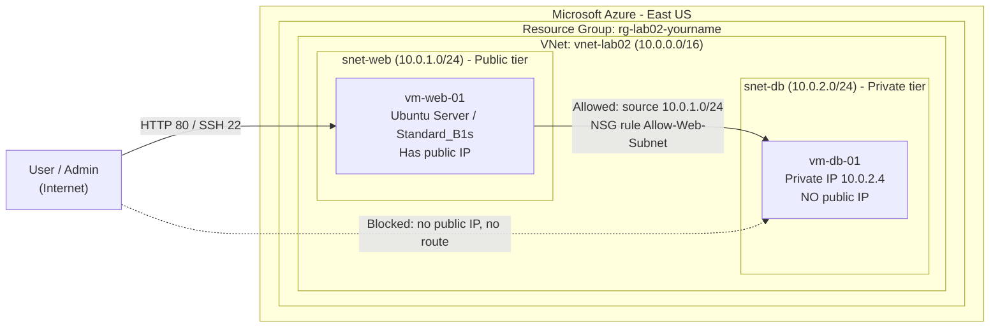
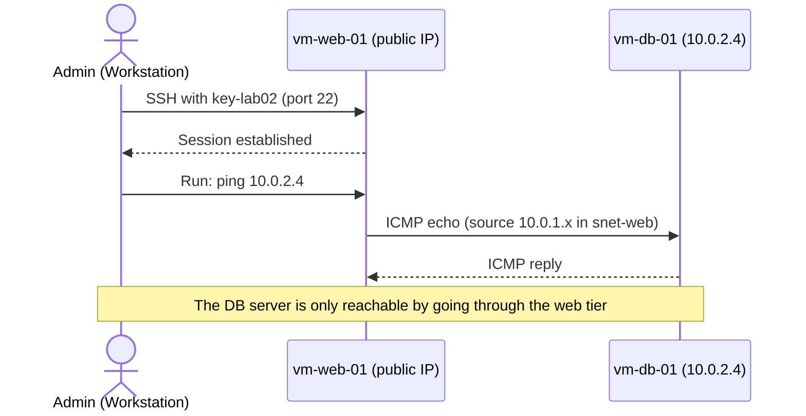

# Building a Secure 2-Tier Web Application in Azure


## [🎬 Watch Me Build This Lab!](https://streamable.com/8t6244)


---

## Table of Contents

1. [Overview](#1-overview)
2. [Architecture](#2-architecture)
3. [Prerequisites](#3-prerequisites)
4. [Lab Variables](#4-lab-variables)
5. [Step-by-Step Instructions](#5-step-by-step-instructions)
6. [Validation](#6-validation)
7. [Security Considerations](#7-security-considerations)
8. [Troubleshooting](#8-troubleshooting)
9. [Clean Up](#9-clean-up)
10. [Key Takeaways](#10-key-takeaways)

---

## 1. Overview

This lab builds a classic **2-tier architecture** in Azure using virtual machines (IaaS). A **web server** sits in a public-facing subnet. A **database server** sits in a private subnet with **no public IP address**. Network Security Groups (NSGs) control which traffic is allowed between the tiers.

The point of the lab is **network segmentation**: keep the sensitive tier off the internet and make the only path to it run through the web tier.

**What this lab demonstrates**

- Designing a virtual network with separate public and private subnets
- Deploying Linux VMs with SSH key authentication
- Removing public exposure from a backend server
- Reaching a private server by jumping through a public one
- Writing an NSG rule that allows traffic only from a specific subnet

**Services used:** Resource Group, Virtual Network (VNet), Subnets, Network Security Groups, Virtual Machines, Public IP

---

## 2. Architecture

### 2.1 Network and Component View



### 2.2 Administrative Access Flow (Jump Host Pattern)



### 2.3 Trust Boundaries and Exposure

| Tier | Resource | Subnet | Public IP | Inbound from internet | Inbound from `snet-web` |
|------|----------|--------|-----------|-----------------------|-------------------------|
| Web | `vm-web-01` | `snet-web` (10.0.1.0/24) | Yes | HTTP (80), SSH (22) | n/a |
| Database | `vm-db-01` | `snet-db` (10.0.2.0/24) | **No** | **None** | Allowed (rule `Allow-Web-Subnet`) |

---

## 3. Prerequisites

- [ ] Active Azure subscription (Free Tier is fine)
- [ ] A terminal with an SSH client (macOS/Linux Terminal, or Windows PowerShell / Windows Terminal)
- [ ] Basic familiarity with the Azure Portal

---

## 4. Lab Variables

| Item | Value |
|------|-------|
| Resource group | `rg-lab02-[yourname]` |
| Region | `East US` |
| Virtual network | `vnet-lab02` (`10.0.0.0/16`) |
| Web subnet | `snet-web` (`10.0.1.0/24`) |
| Database subnet | `snet-db` (`10.0.2.0/24`) |
| Web VM | `vm-web-01` |
| Database VM | `vm-db-01` |
| Image | Ubuntu Server 20.04 LTS |
| Size | `Standard_B1s` |
| SSH key pair | `key-lab02` |

> **Note:** Azure reserves the first four addresses in every subnet, so the first VM deployed to `snet-db` normally receives `10.0.2.4`. Confirm the actual private IP on the VM overview page before testing.

---

## 5. Step-by-Step Instructions

### Phase 1: Build the Network

1. Sign in to the [Azure Portal](https://portal.azure.com).
2. Create a resource group: **Resource groups > + Create**
   - **Name:** `rg-lab02-[yourname]`
   - **Region:** `(US) East US`
3. Create the virtual network: **Virtual networks > + Create**
   - **Resource group:** `rg-lab02-[yourname]`
   - **Name:** `vnet-lab02`
   - **Region:** `(US) East US`
4. On the **IP addresses** tab:
   - Set the address space to `10.0.0.0/16`.
   - Delete the default subnet or rename it, then add two subnets:
     - `snet-web` : `10.0.1.0/24`
     - `snet-db` : `10.0.2.0/24`
5. Click **Review + create**, then **Create**.

**Expected result:** `vnet-lab02` exists with two subnets.

### Phase 2: Deploy the Web Server (Public Tier)

1. Go to **Virtual machines > + Create > Azure virtual machine**.
2. On the **Basics** tab:
   - **Resource group:** `rg-lab02-[yourname]`
   - **Virtual machine name:** `vm-web-01`
   - **Region:** `(US) East US`
   - **Image:** Ubuntu Server 20.04 LTS
   - **Size:** `Standard_B1s`
   - **Authentication type:** SSH public key
   - **Username:** `azureuser` (or your preferred username)
   - **SSH public key source:** Generate new key pair
   - **Key pair name:** `key-lab02`
   - **Public inbound ports:** Allow selected ports, then select **HTTP (80)** and **SSH (22)**
3. On the **Networking** tab:
   - **Virtual network:** `vnet-lab02`
   - **Subnet:** `snet-web`
   - **Public IP:** create new
4. Click **Review + create**, then **Create**.
5. When prompted, **download the private key** (`key-lab02.pem`) and store it somewhere safe. You cannot download it again.

**Expected result:** `vm-web-01` is running and shows a public IP address on its overview page.

### Phase 3: Deploy the Database Server (Private Tier)

1. Go to **Virtual machines > + Create > Azure virtual machine**.
2. On the **Basics** tab:
   - **Virtual machine name:** `vm-db-01`
   - **Region, image, size:** same as the web server
   - **Authentication type:** SSH public key
   - **Username:** same as the web server
   - **SSH public key source:** Use existing key stored in Azure, and select `key-lab02`
   - **Public inbound ports:** **None**
3. On the **Networking** tab:
   - **Virtual network:** `vnet-lab02`
   - **Subnet:** `snet-db`
   - **Public IP:** **None**
4. Click **Review + create**, then **Create**.
5. After deployment, open `vm-db-01` and record its **private IP address** (expected: `10.0.2.4`).

**Expected result:** `vm-db-01` is running with a private IP only. The overview page shows **no public IP address**.

### Phase 4: Reach the Private Server Through the Web Server

The DB server has no public IP, so the only way in is through the web tier.

1. On your workstation, restrict the key file permissions (macOS/Linux):

   ```bash
   chmod 400 key-lab02.pem
   ```

2. Connect to the web server:

   ```bash
   ssh -i key-lab02.pem azureuser@<WEB_VM_PUBLIC_IP>
   ```

3. From inside the web server, test connectivity to the database server:

   ```bash
   ping 10.0.2.4
   ```

4. *(Optional)* Reach the database server's shell in a single command from your workstation, using the web server as a jump host. This keeps your private key on your own machine instead of copying it to an internet-facing server:

   ```bash
   ssh -i key-lab02.pem -J azureuser@<WEB_VM_PUBLIC_IP> azureuser@10.0.2.4
   ```

**Expected result:** you can SSH to the web server from the internet and reach `10.0.2.4` from inside the web subnet.

### Phase 5: Lock Down the Database Subnet with an NSG Rule

1. In the Azure Portal, open the **Network Security Group** attached to `vm-db-01`.
2. Select **Inbound security rules > + Add**.
3. Configure the rule:
   - **Source:** IP Addresses
   - **Source IP addresses/CIDR ranges:** `10.0.1.0/24`
   - **Source port ranges:** `*`
   - **Destination:** Any
   - **Service / Protocol:** as required for your test
   - **Action:** Allow
   - **Priority:** `100`
   - **Name:** `Allow-Web-Subnet`
4. Click **Add**.

**Expected result:** the rule `Allow-Web-Subnet` appears at priority 100. Only the web subnet is explicitly permitted to talk to the database tier.

> **Why this matters:** NSG rules are evaluated from the lowest priority number to the highest, and the first match wins. A low number like `100` means this rule is evaluated early, ahead of the Azure default rules (priority 65000 and above).

---

## 6. Validation

| # | Test | How | Expected result |
|---|------|-----|-----------------|
| 1 | Web VM is reachable | `ssh -i key-lab02.pem azureuser@<WEB_VM_PUBLIC_IP>` | SSH session opens |
| 2 | DB VM has no public IP | Open `vm-db-01` overview in the portal | Public IP field is empty |
| 3 | DB VM not reachable from internet | Try to SSH or ping from your workstation to `10.0.2.4` | No route / timeout |
| 4 | DB VM reachable from the web tier | From `vm-web-01`: `ping 10.0.2.4` | Replies received |
| 5 | NSG rule in place | DB NSG > Inbound security rules | `Allow-Web-Subnet` at priority 100, source `10.0.1.0/24` |

### Evidence

Add screenshots to a `docs/images/` folder and update the paths below.

| Step | Screenshot |
|------|-----------|
| VNet and subnets | `` |
| Web VM overview (public IP) | `` |
| DB VM overview (no public IP) | `` |
| SSH session to web VM | `` |
| Successful ping to 10.0.2.4 | `` |
| NSG rule `Allow-Web-Subnet` | `` |

---

## 7. Security Considerations

| Topic | What to know |
|-------|--------------|
| **Reduce the attack surface** | The database tier has no public IP. An attacker on the internet has no route to it. This is the core design principle of the lab. |
| **Defense in depth** | Protection comes from layers: no public IP, subnet separation, and NSG rules. No single control should be the only thing standing between the internet and the data. |
| **Know the NSG defaults** | Azure NSGs include default rules such as `AllowVnetInBound`, which permits traffic between resources in the same VNet. The explicit `Allow-Web-Subnet` rule documents intent and is the foundation for tightening further (see the hardening step below). |
| **SSH exposed to the internet** | Opening port 22 to `Any` is convenient for a lab but risky. In a real environment, restrict the source to your own IP, or use **Azure Bastion** or **Just-in-Time VM access** so management ports are not permanently exposed. |
| **Protect the private key** | `key-lab02.pem` is the credential for both VMs. Keep it off shared drives and out of Git. Do not copy it to the web server. Use the jump host (`-J`) option instead. |
| **Key-based authentication** | SSH keys are stronger than passwords and are not exposed to password-guessing attacks. |
| **Keep the OS supported** | Ubuntu 20.04 LTS has passed its standard support window. That is acceptable for a short-lived lab, but use a currently supported release for anything you keep running, and apply updates. |
| **Least privilege** | Allow only the sources and ports the application needs. Avoid `Any` as a source or a destination port range without a reason. |
| **Cost and exposure hygiene** | Running VMs and public IPs cost money and expand your exposure. Delete the lab when you are done. |

### Optional Hardening Step

To make the database subnet *strictly* private to the web tier, add a lower-priority rule on the DB NSG that denies all other inbound traffic from the VNet:

| Name | Priority | Source | Action |
|------|----------|--------|--------|
| `Allow-Web-Subnet` | 100 | `10.0.1.0/24` | Allow |
| `Deny-All-Other-Inbound` | 200 | `VirtualNetwork` | Deny |

With this in place, the only subnet that can reach the database tier is `snet-web`, even if more subnets are added to the VNet later.

---

## 8. Troubleshooting

| Issue | Likely cause | Fix |
|-------|--------------|-----|
| **"WARNING: UNPROTECTED PRIVATE KEY FILE"** | Key file permissions are too open | Run `chmod 400 key-lab02.pem`. On Windows, remove inherited permissions so only your user can read the file. |
| **`Permission denied (publickey)`** | Wrong username or wrong key | Confirm the username you set during VM creation and that you are using `key-lab02.pem`. |
| **SSH connection times out** | Port 22 not allowed, or wrong IP | Confirm the web VM's NSG allows SSH (22) and that you are using the current public IP. |
| **Cannot reach `10.0.2.4`** | Wrong private IP, or host firewall | Confirm the DB VM's actual private IP on its overview page, and test from `vm-web-01`, not from your workstation. |
| **`ping` fails from the web VM** | NSG rule or ICMP restrictions | Review the DB NSG inbound rules and confirm the protocol you allowed includes ICMP. |
| **Web page does not load over HTTP** | No web server software installed | Port 80 being open in the NSG does not install a web server. Install and start one (for example, `sudo apt update && sudo apt install -y nginx`). |
| **Lost the `.pem` file** | Azure only offers the download once | Redeploy with a new key pair, or add a new public key to the VM from the portal. |

---

## 9. Clean Up

Virtual machines, disks, and public IPs are billed while they exist. Remove everything when you finish.

1. Go to **Resource groups**.
2. Open `rg-lab02-[yourname]`.
3. Click **Delete resource group**.
4. Type the resource group name to confirm.
5. Click **Delete**.

Deleting the resource group removes the VNet, both VMs, their disks, NICs, NSGs, and the public IP. Also delete `key-lab02.pem` from your workstation if you no longer need it.

---

## 10. Key Takeaways

- Put only what must be public in a public subnet. Everything else belongs in a private tier with no public IP.
- Subnets and NSGs work together: subnets define where things live, and NSGs define who can talk to what.
- A jump host gives you a controlled path to private resources without exposing them directly.
- Defaults matter. Understanding the built-in NSG rules is as important as writing your own.
- Management ports (SSH) are part of your attack surface. Restrict them, or front them with Bastion or JIT access.

---

## Repository Structure

```text
.
├── README.md
└── docs/
    └── images/
```
